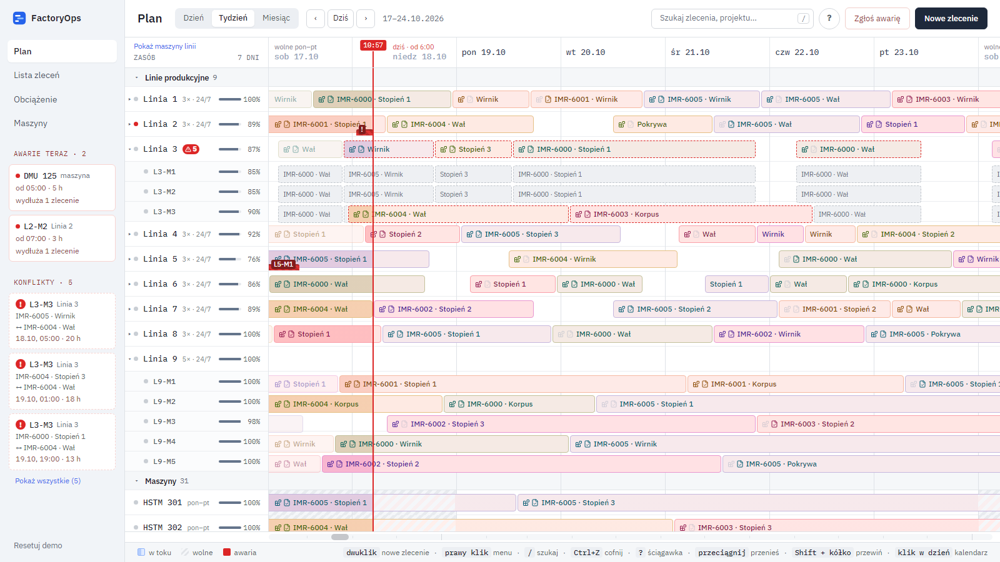
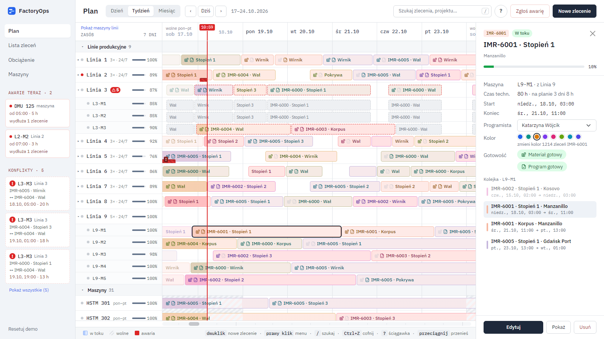
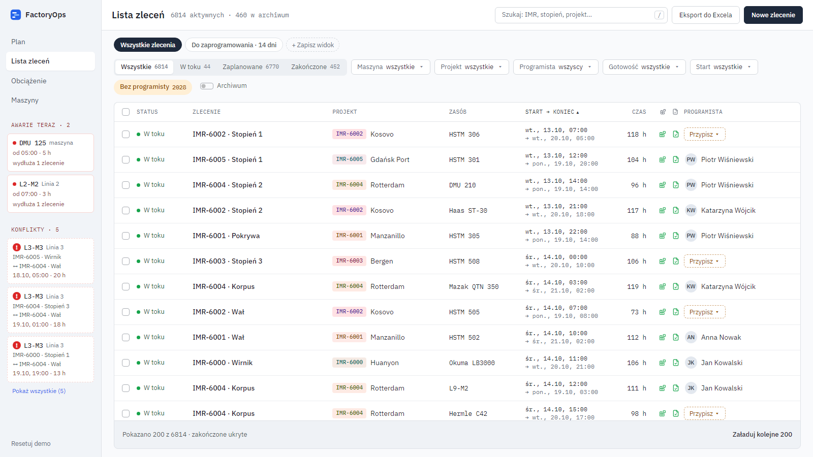
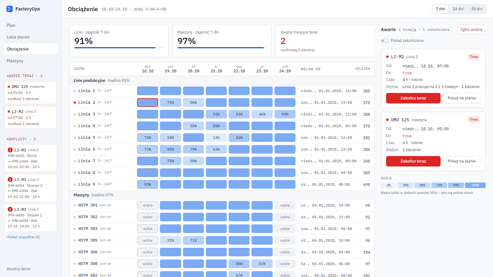
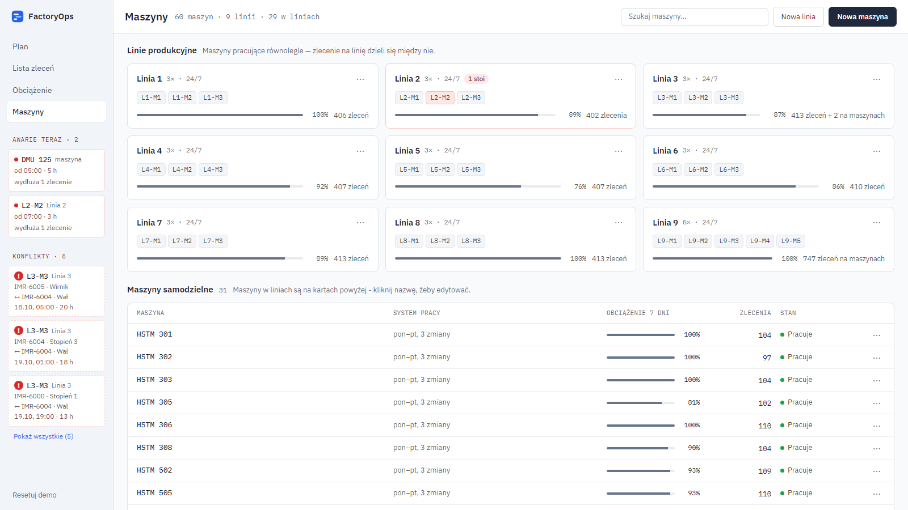
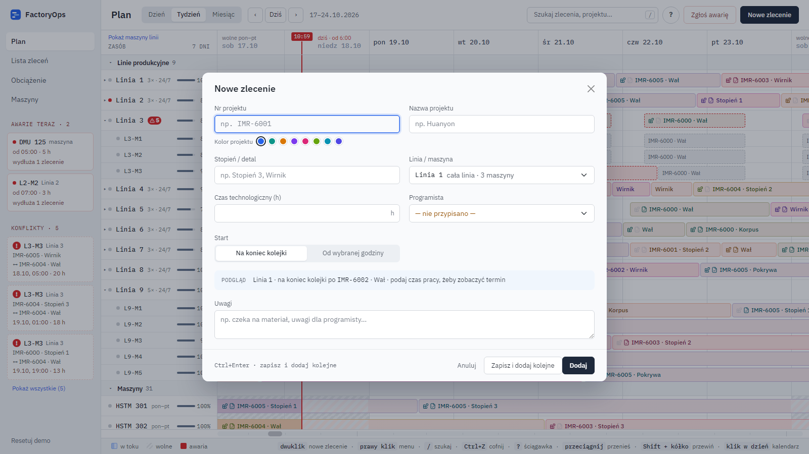

# FactoryOps

FactoryOps is a production planning tool for a machining shop: a planner's desk where orders are scheduled on machines and production lines, with working calendars, breakdowns, conflicts and load in one place.

**Live demo:** [rymarczyk-tomasz.github.io/FactoryOps](https://rymarczyk-tomasz.github.io/FactoryOps/) - runs entirely in the browser on sample data (the UI is in Polish). Changes are kept in the browser and can be undone with `Ctrl+Z` or reset with "Resetuj demo".

## What it can do

### Plan (timeline)

- Orders on a timeline per machine and per production line, in day / week / month view.
- Drag and drop to move an order in time or to another machine; the drop position is shown while dragging. A started order is moved as a whole, a moved or removed order leaves a gap that can be closed with one click.
- Scheduling respects working calendars: shifts per machine (e.g. Mon-Fri, 3 shifts or 24/7), days off, holidays and exceptions for a single day, line or machine. Parts of an order that fall on a day off are hatched.
- Production lines split an order across machines working in parallel; conflicts between line orders and a machine's own orders are detected and listed.
- Breakdowns: report a breakdown on a machine, see it live in the sidebar, and orders behind it are pushed back automatically.
- Load of every machine and line shown right in the row, search with next / previous result, context menus, keyboard shortcuts and a "how it works" cheat sheet.

The side panel shows the order details, its progress, assigned programmer, material and program readiness, project color and the machine's queue.

### Order list

Thousands of orders in a sortable, filterable table: status, machine, project, programmer, readiness and start date filters, multi-level sorting, saved views (e.g. "to be programmed within 14 days"), bulk selection, archive and export to Excel.

### Load

Utilisation of lines and machines day by day for 7 / 14 / 30 days, the date each resource becomes free, its queue length, and the list of ongoing and finished breakdowns.

### Machines and lines

Machines and production lines with their working system, load and order count; adding and editing them in a dialog. Orders of a deleted line or machine are kept as unassigned instead of being lost.

### New order

A new order is added at the end of the queue or from a chosen hour, with a preview of where it will land; technological hours are converted to clock time on the plan.

## Tech stack

- **Frontend** (`frontend/factory-ops`): React 18, TypeScript, Vite, React Router, React Bootstrap / Bootstrap 5, react-calendar-timeline, react-hook-form.
- **Domain logic** (`src/domain`): scheduling, calendars, shifts, lanes, conflicts, load, archive - plain TypeScript, independent of the UI and covered by unit tests (Vitest).
- **Quality:** ESLint, Vitest, TypeScript build checked before every commit.
- **CI/CD:** GitHub Actions builds, tests and deploys the demo to GitHub Pages on every push to `demo`.
- **Backend** (`backend`, work in progress): ASP.NET Core 9 Web API, Entity Framework Core, PostgreSQL in Docker, JWT login.

## Development environment setup

### Software installation

- install [.NET 9.0 SDK](https://dotnet.microsoft.com/en-us/download/dotnet/9.0)
- install [Node.js](https://nodejs.org/) 22 or newer
- install Docker - for Windows: [Docker Desktop](https://www.docker.com/products/docker-desktop/)
- install the Entity Framework tool for dotnet, in terminal type: `dotnet tool install --global dotnet-ef`
- install the development certificate for the backend, in terminal type: `dotnet dev-certs https --trust`
- install frontend packages, in terminal in `./FactoryOps/frontend/factory-ops/` type: `npm install`
- (optional) install backend packages, in terminal in `./FactoryOps/backend/FactoryOps.Api/` type: `dotnet restore`

### Setup database

In terminal:

- run the database locally: go to `./FactoryOps/backend/` and run the PowerShell script `. ./run-database.ps1`, this downloads the Docker image and runs a container with the database.
- go to `./FactoryOps/backend/FactoryOps.Api/` and run the migration `dotnet ef database update`

### Run solution

- local database: PowerShell script `. ./run-database.ps1`
- backend: `dotnet run` in folder `./FactoryOps/backend/FactoryOps.Api/`
- frontend: `npm start` in folder `./FactoryOps/frontend/factory-ops/`

The frontend demo works on its own, without the backend and the database.

### Frontend checks

In `./FactoryOps/frontend/factory-ops/`:

- `npm run lint` - ESLint
- `npm test` - unit tests
- `npm run build` - type check and production build

## Ideas

Feature ideas.

- **Export and print** - export the plan to Excel / PDF and print it for the shift supervisor.
- **Customer due date** - add a due date to an order and warn when the plan finishes it late.
- **Users, roles and change history** - the planner edits, production and sales only view; every change records who moved what and when.
- **Backend and on-premise deployment** - API, database, login, backups; replaces the browser storage used by the demo.
- **KPI dashboard** - machine utilisation, share of orders finished on time, downtime hours from breakdowns.
- **Shop floor view (tablet / TV)** - "what runs on my machine now and next" with a "done" button (simple MES).
- **Automatic scheduling** by priority or due date (APS).
- **What-if scenarios** - a copy of the plan for testing changes before applying them.
- **ERP integration** (e.g. SAP).
